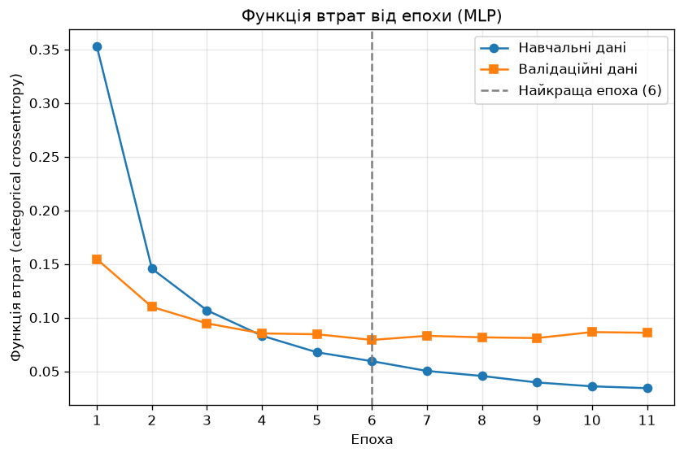
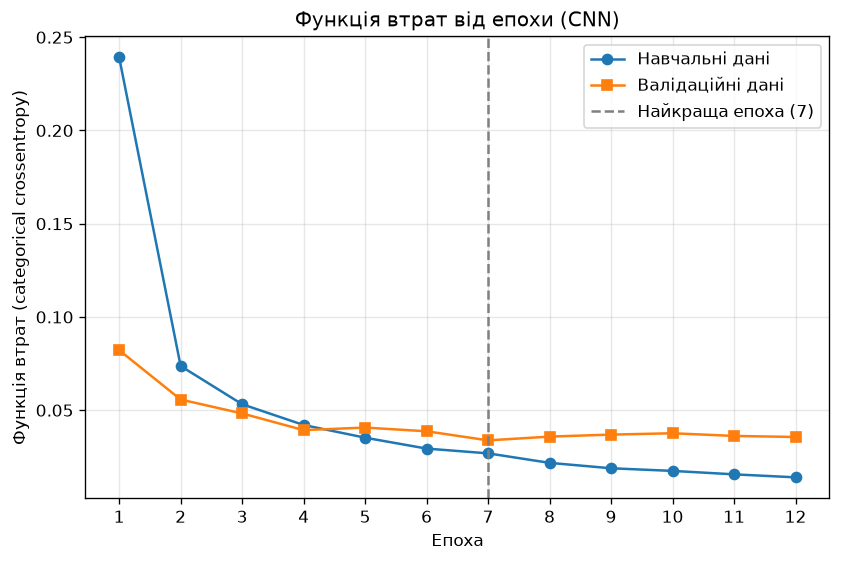
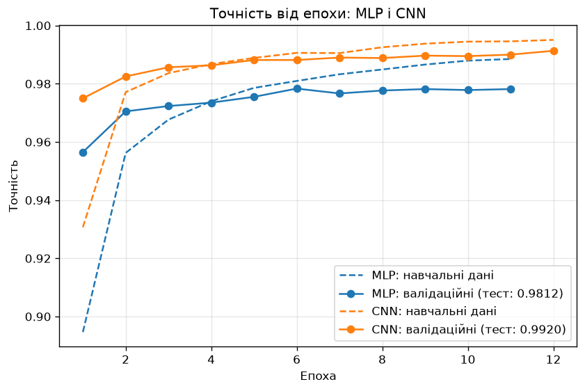
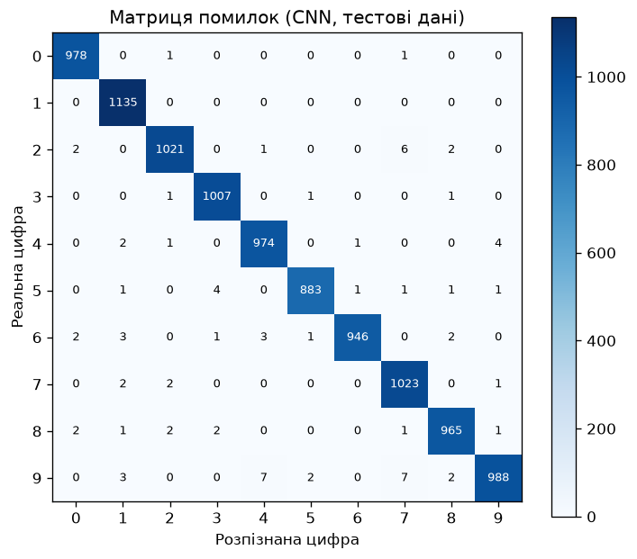
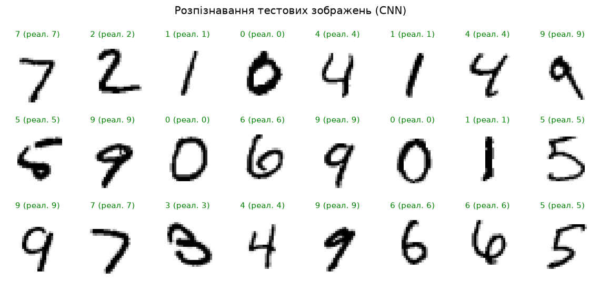
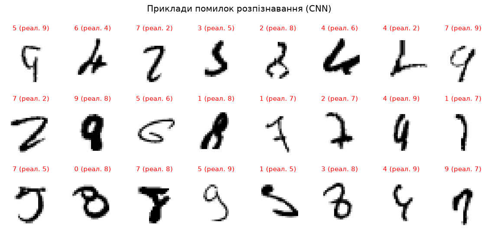

# Розпізнавання рукописних цифр за допомогою ШНМ (Keras)

Лабораторна робота з дисципліни «Основи штучного інтелекту», ДНУ ім. Олеся Гончара.

Програма розпізнає рукописні цифри від 0 до 9 (набір MNIST, зображення 28×28)
за допомогою двох штучних нейронних мереж, побудованих у Keras:

- **MLP**: глибока повнозв'язна мережа з двома прихованими шарами;
- **CNN**: згорткова нейронна мережа.

Вихідний шар має 10 нейронів із функцією активації softmax. Відповідь мережі
обирається за принципом **«переможець забирає все»**: розпізнана цифра відповідає
номеру нейрона з найбільшим значенням виходу (`np.argmax`).

## Завдання

- Розпізнати рукописні цифри 0–9 за допомогою ШНМ.
- Використати глибоку нейронну мережу хоча б з одним прихованим шаром (або згорткову).
- Вихід ШНМ працює за принципом «переможець забирає все».
- Навчання з валідацією в кінці кожної епохи; діаграма залежності функції втрат
  від епохи для навчальних і валідаційних даних.

## Архітектура моделей

| Модель | Шари | Параметрів |
|---|---|---|
| MLP | 784 → Dense(256, ReLU) → Dropout(0.2) → Dense(128, ReLU) → Dropout(0.2) → Dense(10, softmax) | 235 146 |
| CNN | Conv2D(32, 3×3) → MaxPool → Conv2D(64, 3×3) → MaxPool → Flatten → Dropout(0.3) → Dense(128, ReLU) → Dense(10, softmax) | 225 034 |

Параметри навчання: оптимізатор Adam (lr = 0.001), функція втрат
`categorical_crossentropy`, розмір батча 128, до 20 епох. 10 % навчальної
вибірки відкладено для валідації. Навчання зупиняється, якщо втрати на валідації
не покращуються 5 епох (`EarlyStopping`), після чого відновлюються ваги найкращої епохи.

## Результати

| Модель | Точність на тестових даних | Помилок з 10 000 |
|---|---|---|
| MLP | 0.9812 | 188 |
| CNN | **0.9920** | 80 |

### Функція втрат від епохи

| MLP | CNN |
|---|---|
|  |  |

### Точність від епохи



### Матриця помилок (CNN)



### Приклади розпізнавання





## Дані

Файли `mnist_train.csv` (60 000 зображень) і `mnist_test.csv` (10 000 зображень)
не входять до репозиторію через розмір (файл навчальних даних більший за 100 МБ,
ліміт GitHub). Формат: рядок заголовка, далі в кожному рядку мітка цифри
та 784 значення яскравості пікселів (0–255).

Такі самі файли можна завантажити з Kaggle:
[MNIST in CSV](https://www.kaggle.com/datasets/oddrationale/mnist-in-csv).
Їх потрібно покласти в одну папку з `lab03_mnist.py`.

## Запуск

```bash
python -m venv .venv
source .venv/bin/activate
pip install -r requirements.txt
python lab03_mnist.py
```

Для Python 3.14 TensorFlow наразі доступний лише як попередній реліз; якщо `pip`
його не знаходить, установіть з прапорцем `--pre`:

```bash
pip install --pre -r requirements.txt
```

Програма виводить у консоль хід навчання, точність на тестових даних, приклад
роботи принципу «переможець забирає все» та точність по кожній цифрі, а також
зберігає графіки `fig1`–`fig7` у папку зі скриптом.

## Структура

```
.
├── lab03_mnist.py      # програма
├── requirements.txt    # залежності
├── fig1_samples.png    # приклади зображень
├── fig2_mlp_loss.png   # втрати MLP
├── fig3_cnn_loss.png   # втрати CNN
├── fig4_accuracy_compare.png
├── fig5_confusion.png
├── fig6_predictions.png
└── fig7_errors.png
```
